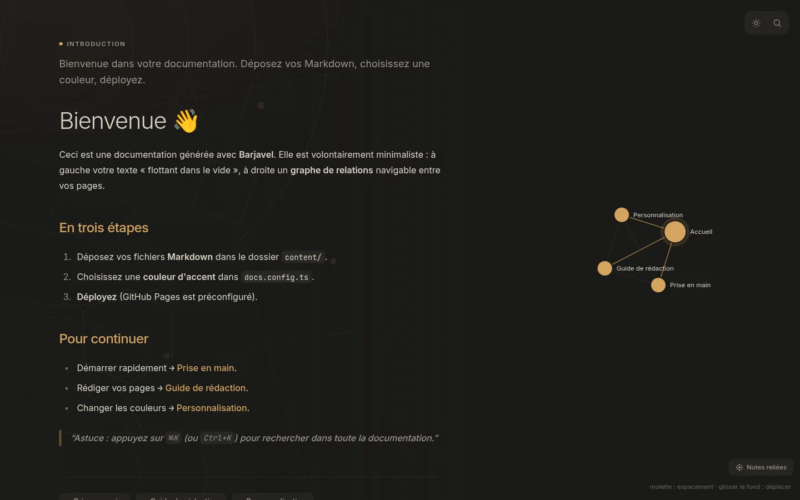
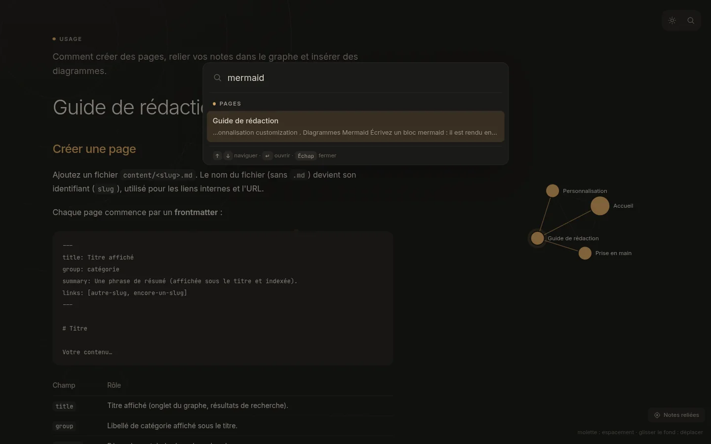
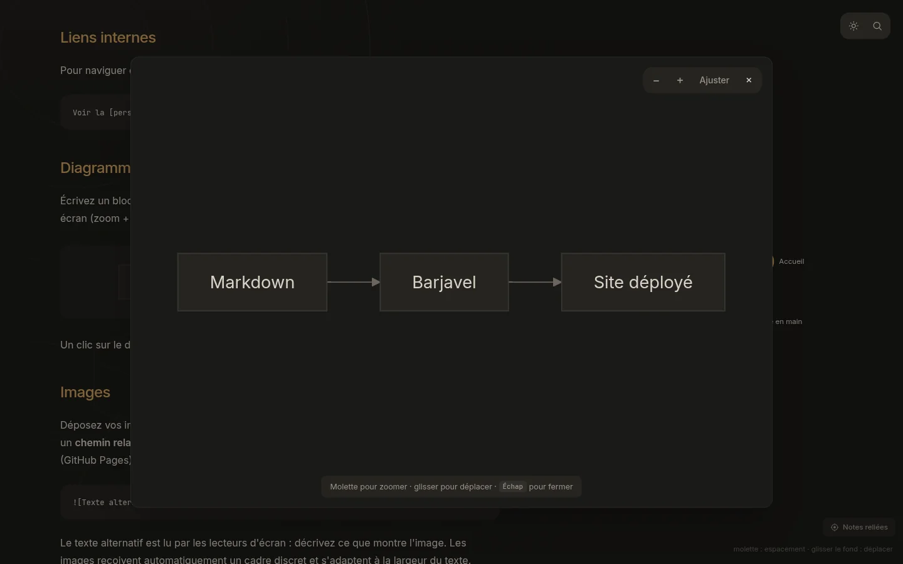
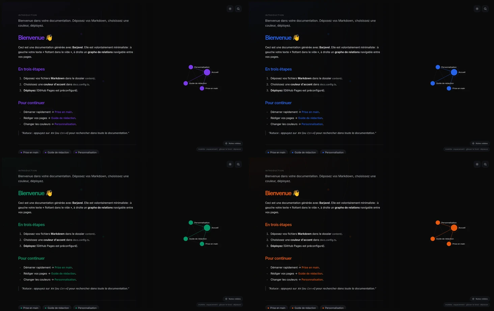

# Barjavel

**Déposez vos Markdown, choisissez une couleur, déployez.**

Barjavel est un générateur de site de documentation minimaliste et élégant,
distribué comme **dépendance npm avec CLI**. Votre projet ne contient que votre
contenu (`content/*.md`) et une configuration (`docs.config.ts`) : le moteur vit
dans le package et se met à jour avec un simple `npm update`.



## ✨ Fonctionnalités

- 📝 **Markdown** (GFM) : titres, tableaux, blocs de code (bouton « copier »)…
- 🕸️ **Graphe de relations** navigable, construit automatiquement entre vos pages.
- 🔎 **Recherche** instantanée (`⌘K` / `Ctrl+K`).
- 🌗 **Thème clair / sombre** persistant (suit la préférence système).
- 🎨 **Une seule couleur d'accent** à changer, appliquée partout.
- 📈 **Diagrammes Mermaid** (` ```mermaid `), plein écran avec zoom.
- 📱 **PWA** : installable et consultable **hors-ligne** (manifeste + service worker générés).
- ⚡ **Statique** : se déploie n'importe où (GitHub Pages préconfiguré).

| Recherche `⌘K`                                         | Mermaid en plein écran                                                      |
| ------------------------------------------------------ | --------------------------------------------------------------------------- |
|  |  |

## 🚀 Démarrer

Dans un dossier, créez trois choses :

```
mon-projet/
├── package.json        # dépend de "barjavel"
├── docs.config.ts      # titre + couleur
└── content/
    └── index.md        # votre première page
```

`package.json` minimal :

```json
{
  "name": "ma-doc",
  "private": true,
  "type": "module",
  "scripts": {
    "dev": "barjavel dev",
    "build": "barjavel build",
    "preview": "barjavel preview"
  },
  "dependencies": {
    "barjavel": "^1.0.0"
  }
}
```

`docs.config.ts` :

```ts
import type { DocsConfig } from "barjavel"

const config: DocsConfig = {
  title: "Ma Documentation",
  description: "Une documentation simple, propre et déployable en un clic.",
  accent: "#2563eb",
}

export default config
```

Puis :

```bash
npm install
npm run dev        # http://localhost:5173
```

## 🖥️ Le CLI

```bash
barjavel dev        # serveur de développement (HMR sur content/ et docs.config.ts)
barjavel build      # génère le site statique dans ./dist
barjavel preview    # sert ./dist localement

# options : --base <chemin>  --port <n>  --open  --outDir <dossier>
```

## ✏️ Ajouter une page

Créez `content/<slug>.md` avec un frontmatter :

```markdown
---
title: Titre affiché
group: catégorie
summary: Une phrase de résumé (indexée par la recherche).
links: [autre-slug, encore-un-slug]
---

# Titre

Contenu… avec un lien interne : [voir le guide](#guide).
```

- Le **graphe** est dérivé du champ `links` (relations bidirectionnelles).
- Les liens internes s'écrivent `[texte](#slug)` et naviguent sans recharger.
- La page d'accueil est `content/index.md`.

## 🎨 Changer la couleur

Dans `docs.config.ts`, une seule valeur hexadécimale :

```ts
accent: "#2563eb", // bleu — ou #059669 (vert), #e11d48 (rose), #ea580c (orange)…
```

Optionnellement, un accent différent par thème via `accentDark` / `accentLight`.



## 🖼️ Icônes & PWA

Le manifeste et le service worker sont **générés** depuis `docs.config.ts`.
Pour personnaliser les icônes, déposez les vôtres dans `public/icons/`
(`icon.svg`, `icon-192.png`, `icon-512.png`, `icon-maskable-512.png`) : elles
remplacent celles par défaut.

## 🌐 Déploiement (GitHub Pages)

Le site est compilé avec des chemins relatifs (`base: './'`), il fonctionne donc
aussi bien à la racine d'un domaine que dans un sous-chemin
`https://<utilisateur>.github.io/<repo>/`. Un workflow prêt à l'emploi :

```yaml
# .github/workflows/deploy.yml
name: Deploy to GitHub Pages
on:
  push: { branches: [main] }
permissions: { contents: read, pages: write, id-token: write }
jobs:
  build:
    runs-on: ubuntu-latest
    steps:
      - uses: actions/checkout@v4
      - uses: actions/setup-node@v4
        with: { node-version: 22, cache: npm }
      - uses: actions/configure-pages@v5
        with: { enablement: true }
      - run: npm ci
      - run: npm run build
      - uses: actions/upload-pages-artifact@v3
        with: { path: dist }
  deploy:
    needs: build
    runs-on: ubuntu-latest
    environment: { name: github-pages, url: "${{ steps.deployment.outputs.page_url }}" }
    steps:
      - id: deployment
        uses: actions/deploy-pages@v4
```

## 🗂️ Ce dépôt

Ce dépôt **est** le package `barjavel`, et se documente avec lui-même (dogfood) :

```
barjavel/
├── bin/barjavel.mjs     # le CLI (dev / build / preview)
├── vite/plugin.mjs      # plugin Vite : modules virtuels contenu/config + PWA
├── app/                 # le moteur (React + Vite) : index.html, composants, styles
├── assets/              # PWA par défaut (service worker, icônes)
├── content/*.md         # la doc de Barjavel (exemple + dogfood, non publié)
├── public/images/       # captures d'écran utilisées par la doc et ce README
├── docs.config.ts       # config de cette doc (non publié)
└── .github/workflows/   # ci, deploy (Pages), publish (npm sur tag v*)
```

Développement local du moteur : `npm install && npm run dev`.
Publication : pousser un tag `v*` (nécessite le secret `NPM_TOKEN`).

## 📄 Licence

MIT — voir [LICENSE](./LICENSE).
