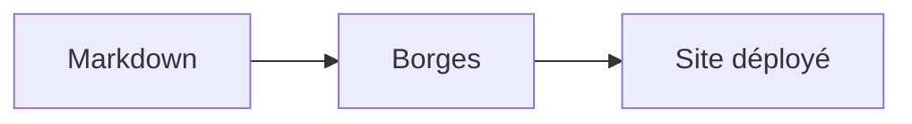

# Guide de rédaction

## Créer une page

Ajoutez un fichier `content/<slug>.md`. Le nom du fichier (sans `.md`) devient
son identifiant (`slug`), utilisé pour les liens internes et l'URL.

Chaque page commence par un **frontmatter** :

```markdown
---
title: Titre affiché
group: catégorie
summary: Une phrase de résumé (affichée sous le titre et indexée).
links: [autre-slug, encore-un-slug]
---

# Titre

Votre contenu…
```

| Champ     | Rôle                                                             |
| --------- | ---------------------------------------------------------------- |
| `title`   | Titre affiché (onglet du graphe, résultats de recherche).        |
| `group`   | Libellé de catégorie affiché sous le titre.                      |
| `summary` | Résumé court, indexé par la recherche.                           |
| `links`   | Slugs des pages reliées → **arêtes du graphe** (bidirectionnel). |

## Relier vos pages (le graphe)

Le graphe de droite est construit **automatiquement** à partir du champ
`links`. Reliez `a` à `b` et une arête apparaît entre les deux nœuds. Plus une
page est centrale, plus son nœud est gros.

La page d'accueil est `content/index.md`.

## Liens internes

Pour naviguer d'une page à l'autre sans rechargement, utilisez `#slug` :

```markdown
Voir la [personnalisation](#customization).
```

## Diagrammes Mermaid

Écrivez un bloc ` ```mermaid ` : il est rendu en diagramme, cliquable pour
s'ouvrir en plein écran (zoom + déplacement). Ses couleurs suivent le thème.



## Le reste

Tout le **Markdown** standard fonctionne (GFM) : titres, listes, tableaux,
blocs de code (avec bouton « copier »), citations, images, etc.
